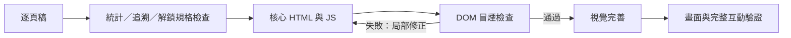

# Workflow Graph V2｜依實際錯誤調整

## 觀察依據

V1 在 N13 的 DOM 互動測試第一次執行時發現：CASE-01 答對後，下一案按鈕仍被停用。根因為 `site/app.js` 的 `unlocked()` 頁碼門檻偏移，沒有把「完成案件 01 → 開啟投影片 05」正確映射。修正後，五案循序解鎖及最終測驗測試通過。此為自然發生的錯誤，並非刻意注入。

## V2 圖形變更

沿用 V1 的 N01–N15 節點與來源、證據權限。將「案件頁次／解鎖狀態對照」列入 N11 的內容規格檢查，要求先核對 01→05、02→07、03→09、04→11、05→13 的映射。N12 在完成前端核心邏輯後，**立即執行 DOM 冒煙測試**，通過才進入視覺完善及 N13 的完整互動驗證。若冒煙測試失敗，只返回 N12 的對應解鎖功能，無須重建 Wiki。

## 比較限制

V1 實際觀察到一次解鎖失敗；V2 修正後的 DOM 測試通過。這證明本次回歸檢查能攔截同類錯誤，不表示長期錯誤率下降。實際瀏覽器畫面與手機操作因本機 `file:` URL 被瀏覽器工具政策阻擋，尚未完成；V2 也不能宣稱這部分通過。
